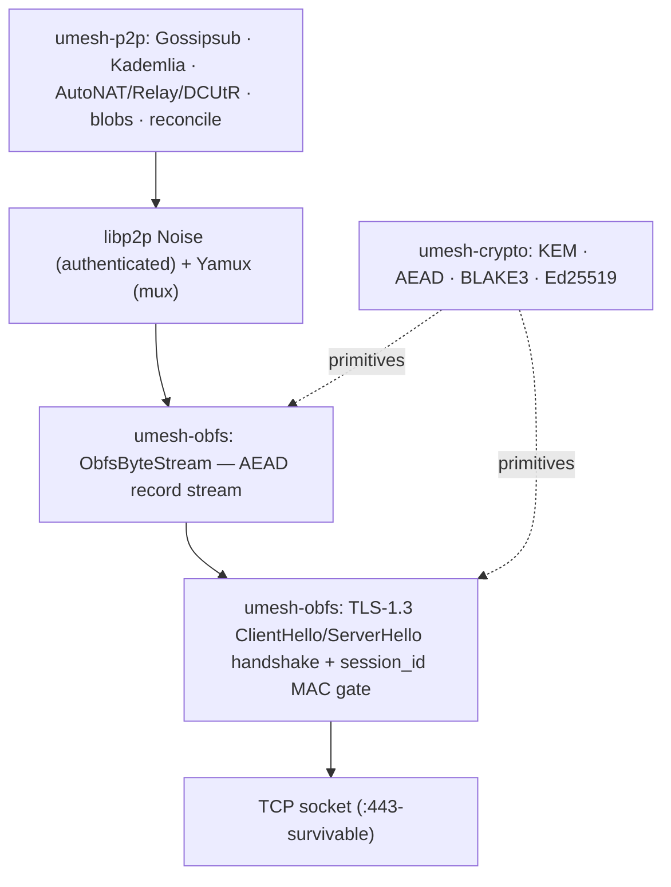
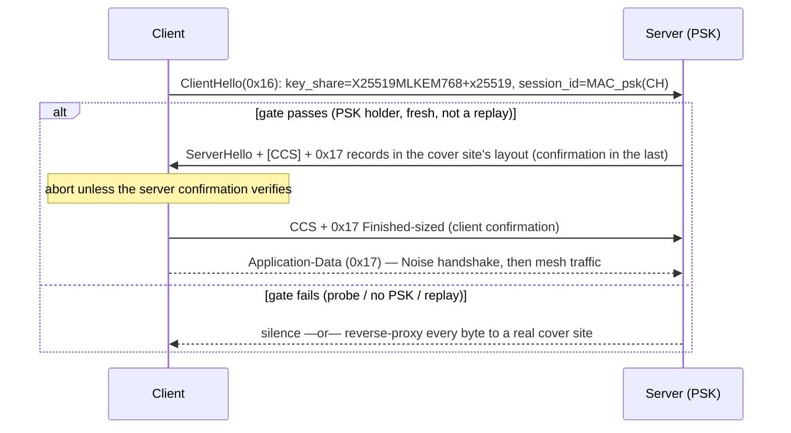
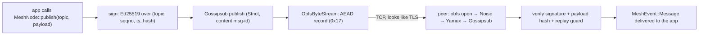

# Architecture

A technical tour of **uber-mesh** for contributors. It explains the layering, the crates and their key
types, the on-wire formats, and how a message flows from `publish` to verified delivery. Pair this with
the design artifacts under [`specs/001-uber-mesh-core/`](specs/001-uber-mesh-core/) and the rationale in
[`docs/research/dossier.md`](docs/research/dossier.md).

## Design in one sentence

> A **pluggable obfuscation carrier** sits *below* libp2p's **Noise** channel, which carries a
> **decentralized gossip overlay**, all keyed by a **hybrid post-quantum** crypto core — so the whole
> mesh inherits the carrier's DPI resistance and every link is hybrid-PQ end to end.

## The layered model — and why obfs is *below* Noise

libp2p already gives us an authenticated, multiplexed secure channel (Noise + Yamux). uber-mesh does **not**
replace it; it wraps the raw TCP socket in the obfuscation carrier *before* Noise runs. The consequence is
important:

- Everything libp2p sends — including the Noise handshake — travels inside the obfs AEAD record stream.
  A DPI box sees a single TLS-1.3-looking flow, never a Noise handshake or a libp2p protocol negotiation.
- The obfs handshake performs its **own** hybrid X25519+ML-KEM-768 key agreement, so the data path is
  post-quantum even though stock libp2p Noise is classical — defeating harvest-now-decrypt-later for mesh
  data without forking libp2p's security layer.

The wiring lives in `umesh-p2p::behaviour::build_swarm`, which uses
`SwarmBuilder::with_other_transport` to layer: **TCP → obfs handshake (client/server) →
`ObfsByteStream` (via `tokio_util::compat` to bridge futures-io ↔ tokio-io) → Noise → Yamux → relay
client**. A wrong-PSK peer fails the obfs gate and never reaches Noise.

## Crates

### `umesh-crypto` — the pure-Rust core (`#![forbid(unsafe_code)]`)

| Concern | What it provides | Where |
|---|---|---|
| Hybrid KEM | **X-Wing** (X25519 + ML-KEM-768, SHA3-256 combiner, SHAKE256 seed keygen) per `draft-connolly-cfrg-xwing-kem-11`, **KAT-verified** byte-for-byte against the draft's official vectors (`tests/xwing_kat.rs`); `Initiator::start` / `respond` / `Initiator::finish` return a shared secret. | `kem.rs` |
| Identity | Ed25519 keypair; `PeerId = BLAKE3(verifying_key)`; verification uses `verify_strict`. | `identity.rs` |
| Hashing & KDF | BLAKE3 `hash`, `derive_key(label, ikm)`, `keyed_mac(key, data)`, and `Cid` — all with **strict domain-separation labels** (one label per use: traffic keys, obfs frame/MAC, CID, PoW, …). | `hash.rs` |
| AEAD | XChaCha20-Poly1305 (`AeadKey`, `seal`/`open`). | `aead.rs` |
| Integrity | RFC 9162 Merkle trees with distinct leaf/node/root labels (root commits to the tree size); proof-of-work. | `merkle.rs`, `pow.rs` |

The PQ half is treated as **defense-in-depth, not authority**: the classical X25519 secret is always mixed
in, so a break of ML-KEM-768 alone cannot recover a session key. KATs: the official X-Wing draft-11
vectors in [`tests/xwing_kat.rs`](crates/umesh-crypto/tests/xwing_kat.rs), plus BLAKE3 empty-input and
RFC 7748 §5.2 X25519 in [`tests/kat.rs`](crates/umesh-crypto/tests/kat.rs); property tests
(AEAD round-trip + bit-flip, CID determinism, Merkle membership) in
[`tests/props.rs`](crates/umesh-crypto/tests/props.rs).

### `umesh-obfs` — the obfuscation carrier

The first concrete `ObfsTransport` is **obfs-tcp**. Modules:

- **`tls`** — builds/parses structurally-valid TLS 1.3 ClientHello/ServerHello records (see
  [Wire format](#wire-format-the-obfs-handshake)).
- **`handshake`** — the probe-resistant hybrid key agreement and the `session_id` MAC gate; `ProbeResponse`
  (`Silence` | `Fallback(host:port)`).
- **`secure` / `bytestream`** — `SecureStream` and the poll-based `ObfsByteStream` (AsyncRead/Write over the
  AEAD record framing).
- **`wire`** — TLS record framing helpers and the censor "fully-encrypted" classifier model used as a test
  oracle (`looks_fully_encrypted`, `is_tls_record_header`).
- **`shaping` / `profile`** — length-hiding padding + inter-arrival-time policy, and environment profiles
  that select transport + shaping; **`transport`** — `ObfsTcp` + connect-time endpoint rotation.

### `umesh-p2p` — the libp2p overlay

`MeshBehaviour` composes Gossipsub (Strict signing, peer scoring, content-derived message-ids), a **private**
Kademlia (`/uber-mesh/kad/1.0.0`), identify, ping, the NAT trio (AutoNAT v2 / Circuit Relay v2 / DCUtR), a
blob request/response protocol (`/uber-mesh/blobs/1.0.0`, bincode codec) and set reconciliation
(`/uber-mesh/reconcile/1.0.0`). `MeshNode` is the driver (`next_event` → `MeshEvent`); `gossip` holds the
signed-message type + replay guard; `store` is the content-addressed `ContentStore`; `metrics` exposes the
Prometheus counters/gauges/histogram.

### `umesh-node` & `uber-mesh`

`umesh-node` owns config (TOML), the identity keystore (`0600` files), the runtime, and a **secret-free**
`NodeStatus`. `uber-mesh` is the clap CLI: `init`, `run`, `mesh`, `status`, `keys show` — `mesh` runs the
real libp2p overlay and serves Prometheus `/metrics`.

## Wire format: the obfs handshake

The handshake is **obfs wire v2.1** (normative spec:
[`contracts/handshake-wire.md`](specs/001-uber-mesh-core/contracts/handshake-wire.md)). On the wire it is a
complete-looking PQ TLS 1.3 opening:

| Flight | Wire | What it really carries |
|---|---|---|
| ClientHello (`0x16`) | **exactly** desktop Chrome 133+ (JA4 `t13d1516h2_8daaf6152771_d8a2da3f94cd`): GREASE, 15 suites, 16 extensions permuted per connection, GREASE ECH; SNI = the listener's cover domain; `key_share` = `X25519MLKEM768` (`0x11EC`, 1216 B) + an X25519 share | our hybrid KEM material; `session_id` = keyed MAC over the **whole** ClientHello (session_id zeroed) — 32 random-looking bytes, no cleartext epoch |
| ServerHello + [CCS] + `0x17` records | **the cover site's own layout** (cover mode): same ServerHello suite/group/length, CCS presence and record sizes the real site sends to this ClientHello; else a PSK-derived default | server KEM share (in the ServerHello, or masked at the start of the flight when the cover picks plain x25519); the last 53 B of the last record = AEAD **server key confirmation** |
| CCS + `0x17` (Finished-sized for the suite: 53/69 B) | looks like the client Finished | AEAD **client key confirmation** |

**Cover profile.** In cover mode (`ProbeResponse::Cover`) the listener connects to its cover site with our own
Chrome ClientHello at startup and every 30 min ± 5 min, records the real flight's record layout
(`umesh-obfs::cover`), keeps the last good one on failure, and reproduces it for authenticated clients; the
client accepts any layout within 8 records / 32 KiB and trial-opens the tail of each record to find the
confirmation.

**Gate & probe resistance.** The server checks the MAC for epochs e−1, e, e+1 in constant time and rejects
replays via a bounded per-epoch cache. Anything that fails — non-TLS bytes, a wrong MAC, a replay — gets the
configured probe response: silence, or a transparent reverse proxy to a real cover site that receives
**every byte already read** (REALITY/ShadowTLS model).

**Key schedule.** `transcript = H(ClientHello ‖ ServerHello [‖ in-flight ML-KEM ct])`,
`master = KDF(ss_hybrid ‖ KDF(psk) ‖ transcript)`; confirmations, the two directional traffic keys and a
public **channel binding** are separate labelled derivations of `master`. The client sends nothing after the
ClientHello until the server's confirmation verifies, so a man-in-the-middle without the PSK learns nothing
— not even that the client speaks libp2p.

**TLS-terminating middlebox.** A full MITM (CA trusted by the client device) must send its own ClientHello,
which fails the gate and is proxied to the real cover site — the bridge looks exactly like the cover. Our
client finds no confirmation in the MITM's flight and fails closed without sending anything after its hello.
No tunnel survives a full MITM: the guarantee is non-identification of the bridge, not reachability.

**Residual gaps:** one Chrome generation/platform is imitated; the cover domain does not resolve to the bridge
IP; one layout sample per refresh (real per-connection variance is not reproduced) and unauthenticated
learning; no NewSessionTicket records. See [`contracts/handshake-wire.md`](specs/001-uber-mesh-core/contracts/handshake-wire.md)
and [`docs/security-and-deferred.md`](docs/security-and-deferred.md).

### The AEAD record stream

After the handshake, both sides derive **directional** AEAD keys (client→server and server→client) from the
shared secret via labeled BLAKE3 derivation. `ObfsByteStream` then frames application bytes into
XChaCha20-Poly1305 records inside TLS application-data framing (`0x17`), with a direction tag and a monotonic
counter bound into the AEAD associated data, plus length-hiding padding and optional IAT shaping. Tampering or
counter desync fails decryption (tested).

## Identity, gossip, and content addressing

- **Identity.** A node is an Ed25519 keypair; its application `PeerId` is `BLAKE3(verifying_key)`. (Note: the
  libp2p transport `PeerId` is a separate multihash — the two namespaces are distinct.)
- **Signed gossip + replay protection.** A gossip message binds `(topic, sender, sender_key, seqno, timestamp,
  payload_hash)` and is Ed25519-signed. Validation is a stateless signature + payload-hash check, plus a
  stateful **replay guard**: monotonic per-sender seqno, a timestamp window, and an LRU dedup cache.
  Gossipsub itself runs Strict (signed) with peer scoring and content-derived message-ids.
- **Content addressing.** A `Cid` is `BLAKE3` over the content; blob transfers verify `BLAKE3(bytes) == cid`
  on receipt, and **negentropy-style range-based set reconciliation** lets two peers efficiently discover
  which content each is missing.
- **End-to-end sealed topics (`umesh-p2p::sealed`).** Link encryption (obfs + Noise) ends at every hop, so
  forwarders and serving peers would otherwise read what they relay. A topic with a shared 32-byte topic key
  carries format-v3 messages whose payload is XChaCha20-Poly1305 ciphertext under a per-epoch key derived
  from `(topic_key, topic)`, AAD-bound to version/topic/sender/seqno/timestamp; the signature covers the
  ciphertext, so non-members still validate and forward but never deliver. Blobs shared in a sealed topic
  are encrypted under a fresh content key with `Cid` over the ciphertext; `(cid, key)` travels inside a sealed
  message. Topics without a key stay public (v2).

## Data flow: a gossip message, end to end

A forged or replayed message fails verification at `V` and is dropped (and the sender is penalized by
gossipsub scoring); a peer without the PSK never establishes the obfs session at `N` in the first place.

## Observability

Nodes can serve a hand-rolled Prometheus exposition endpoint (`umesh-p2p::metrics`). It is **off by
default** — an unauthenticated plaintext endpoint would identify the host to a censor's scanner — and is
enabled with `--metrics-addr` / `UMESH_METRICS_ADDR` (a bare port binds `127.0.0.1`): connection gauges, gossip/blob/sync counters, an obfs **handshake
latency histogram**, and per-process resource metrics (`umesh_process_*` read from `/proc/self`). The
[`docker/`](docker/) directory scales this to 100-node clusters scraped by Prometheus (DNS-SD) with a
provisioned Grafana dashboard, under `tc-netem` impairment — see [`docs/benchmarks.md`](docs/benchmarks.md).

## Extending the transport

New carriers (native REALITY, QUIC+Salamander, AmneziaWG, local-RF) are **additive behind the
`ObfsTransport` seam** — they do not touch the crypto core or the overlay. Each deferred carrier and its
dependency rationale is documented in [`docs/security-and-deferred.md`](docs/security-and-deferred.md). When
adding one, follow the test-first rule (constitution Principle V): wire parsers need fuzz harnesses and the
DPI model in [`tests/dpi_middlebox.rs`](crates/umesh-obfs/tests/dpi_middlebox.rs) must still pass.
