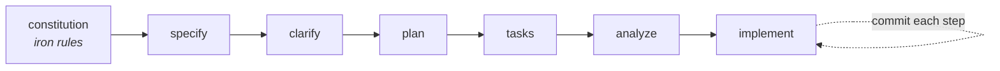
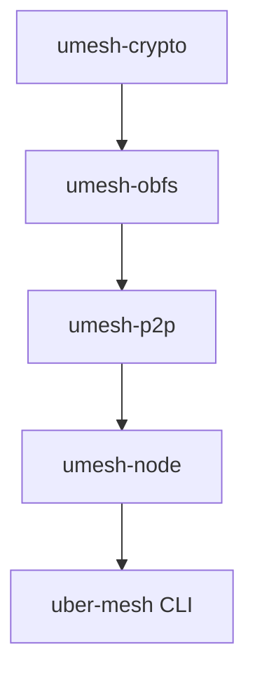

# Contributing to uber-mesh

[](https://github.com/AlexMelanFromRingo/uber-mesh/actions/workflows/ci.yml)
[](LICENSE)
[](https://www.rust-lang.org)
[](https://doc.rust-lang.org/edition-guide/)

Thanks for your interest in uber-mesh — a decentralized, censorship-resistant peer-to-peer mesh
built to survive hostile DPI environments. Contributions are very welcome, whether that's a bug fix,
a new obfuscation carrier, a sharper test, or a documentation improvement.

This is a **security tool**. The bar for code that touches cryptography, the wire protocol, or the
obfuscation layer is deliberately high. This guide explains how to work within that bar without
friction.

> [!IMPORTANT]
> The project's **iron rules** live in [`.specify/memory/constitution.md`](.specify/memory/constitution.md)
> (v1.0.0). Where this guide and the constitution disagree, **the constitution wins**. Two principles
> are explicitly **non-negotiable**: Principle I (Security & Cryptography First) and Principle V
> (Test-First & Cryptographic Verification).

---

## Table of contents

- [Prerequisites](#prerequisites)
- [The development loop](#the-development-loop)
- [Test-first rule for crypto / protocol / parser code](#test-first-rule-for-crypto--protocol--parser-code)
- [Default-deny `unsafe`](#default-deny-unsafe)
- [Fuzzing](#fuzzing)
- [Spec-driven workflow](#spec-driven-workflow)
- [Commit conventions](#commit-conventions)
- [Security-sensitive review](#security-sensitive-review)
- [Repository layout](#repository-layout)

---

## Prerequisites

| Tool | Version | Notes |
| --- | --- | --- |
| Rust (stable) | **1.85+** | Workspace pins `rust-version = "1.85"`, **edition 2024**, `resolver = "3"`. |
| `rustfmt`, `clippy` | matching toolchain | `rustup component add rustfmt clippy` |
| `cargo-deny` | latest | Supply-chain gate: `cargo install cargo-deny` |
| Rust **nightly** + `cargo-fuzz` | latest | **Only** needed to run the fuzz harnesses — see [Fuzzing](#fuzzing). Not required for normal development. |

The default build is **pure-Rust** with no C/FFI dependencies. You should not need a system TLS or
crypto stack to build or test the workspace.

```bash
git clone https://github.com/AlexMelanFromRingo/uber-mesh
cd uber-mesh
cargo build --workspace
```

> [!NOTE]
> The `fuzz/` crate is a **standalone workspace** (it is in the top-level `exclude` list and pins
> edition 2021 + libfuzzer). It is intentionally not part of `cargo build --workspace`, so the
> nightly/libfuzzer toolchain never bleeds into the main build.

---

## The development loop

CI runs exactly the checks below, with `RUSTFLAGS="-D warnings"`. Run them locally before you push
and the pipeline will stay green. Each step mirrors a CI job verbatim.

```bash
# 1. Format (must be clean — CI uses --check)
cargo fmt --all

# 2. Lint with warnings as errors
cargo clippy --workspace --all-targets -- -D warnings

# 3. Build the whole workspace
cargo build --workspace

# 4. Run the full test suite (currently 99 tests, all green)
cargo test --workspace

# 5. Supply-chain audit (advisories, bans, licenses, sources)
cargo deny check
```

The exact CI invocations, for reference:

| CI step | Command |
| --- | --- |
| fmt | `cargo fmt --all --check` |
| clippy | `cargo clippy --workspace --all-targets -- -D warnings` |
| build | `cargo build --workspace` |
| test | `cargo test --workspace` |
| supply-chain | `cargo deny check advisories bans licenses sources` |

A quick pre-push one-liner:

```bash
cargo fmt --all --check && \
cargo clippy --workspace --all-targets -- -D warnings && \
cargo test --workspace && \
cargo deny check
```

> [!WARNING]
> A red pipeline blocks merge (constitution Principle V). `clippy` is run with `-D warnings`, so a
> warning **is** a failure. The supply-chain policy lives in [`deny.toml`](deny.toml): it denies
> yanked/advisory crates, restricts licenses to a permissive allow-list, denies wildcard deps and
> unknown registries/git sources, and warns on duplicate major versions.

---

## Test-first rule for crypto / protocol / parser code

This is **constitution Principle V (NON-NEGOTIABLE)**. New or changed cryptographic, handshake,
wire-protocol, or parser code **must** ship with its tests in the same change. Handshake or parser
code without tests **must not be merged**.

For such code, include the relevant subset of:

- [ ] **Unit tests** — inline `#[test]` / `#[tokio::test]` modules next to the code.
- [ ] **Known-answer tests (KATs)** — verify against the reference vectors of the standard you're
      implementing. See [`crates/umesh-crypto/tests/kat.rs`](crates/umesh-crypto/tests/kat.rs) for the
      pattern (BLAKE3 empty-input, X25519 RFC 7748 §5.2, hybrid X25519+ML-KEM-768 sizes/agreement).
- [ ] **Round-trip / property tests** — `open(seal(x)) == x`, single-bit-flip detection, CID
      determinism, Merkle membership. See [`crates/umesh-crypto/tests/props.rs`](crates/umesh-crypto/tests/props.rs)
      (uses `proptest`).
- [ ] **Fuzz harness** for any new **wire parser** — every byte-parsing surface needs one before
      merge. See [Fuzzing](#fuzzing).

A few practical rules that fall out of Principle I:

- **No hand-rolled primitives.** Use standardized, maintained crates. Composing primitives into a
  protocol is fine, but follow an established construction (X-Wing for the hybrid KEM, Noise patterns
  for handshakes).
- **Hybrid post-quantum, classical-authoritative.** Key agreement is X25519 **+** ML-KEM-768; the
  classical half stays authoritative so that a break in the (pre-audit) PQ half alone cannot
  compromise a session. Don't introduce a PQ-only path.
- **Strict domain separation.** Every distinct hash/KDF use gets its own labeled derivation
  (content IDs, message IDs, PoW, handshake transcript, gate MAC, AEAD key derivation).
- **Secrets stay secret.** Use `zeroize` on drop, `subtle` for constant-time comparisons, and never
  log, serialize-in-clear, or surface key material in errors/telemetry. `NodeStatus` and error
  messages expose fingerprints only — never the PSK or identity seed.
- **Parsers must not panic on hostile input.** Truncated/garbage bytes return an error; they never
  unwrap/index-panic. New parsers should have a test asserting graceful rejection.

If a change claims interop with an external ecosystem (e.g. a real REALITY/Xray or Noise peer), a
conformance test against the canonical implementation's vectors is required **before** that interop
claim may appear in docs.

---

## Default-deny `unsafe`

This is **constitution Principle IV**, enforced at the workspace level in
[`Cargo.toml`](Cargo.toml):

```toml
[workspace.lints.rust]
unsafe_code = "deny"
```

- The whole workspace is **`unsafe_code = "deny"`**.
- The crypto crate goes further with crate-level **`#![forbid(unsafe_code)]`** — zero `unsafe`,
  no exceptions.
- If you ever believe an `unsafe` block is genuinely necessary outside the crypto crate, it requires
  an inline justification comment, reviewer sign-off, **and** a test that exercises it. Undocumented
  `unsafe` is prohibited. In practice: prefer a safe-Rust design, and prefer pure-Rust,
  auditable dependencies. C/FFI deps are allowed **only** behind an explicit feature flag with a
  recorded rationale, never in the default build of the core libraries.

---

## Fuzzing

Wire parsers are fuzzed with `cargo-fuzz` (libFuzzer) on **nightly**. The harnesses live in the
standalone [`fuzz/`](fuzz/) crate.

```bash
# one-time
rustup toolchain install nightly
cargo install cargo-fuzz

# from the fuzz/ directory
cargo +nightly fuzz run obfs_record     # obfs AEAD record / framing parser
cargo +nightly fuzz run message_parse   # signed gossip message decoder
```

When you add a new wire parser, add a matching `fuzz_targets/*.rs` and a `[[bin]]` entry in
[`fuzz/Cargo.toml`](fuzz/Cargo.toml) in the same change (Principle V).

---

## Spec-driven workflow

uber-mesh is developed with **GitHub Spec Kit**. Design precedes implementation, and the artifacts
are checked into the repo. Before writing non-trivial code, read the relevant design docs and make
sure your change is consistent with them.



Where things live:

- **Iron rules** — [`.specify/memory/constitution.md`](.specify/memory/constitution.md) (v1.0.0, 7 principles).
- **Active feature design** — [`specs/001-uber-mesh-core/`](specs/001-uber-mesh-core/):
  `spec.md`, `plan.md`, `tasks.md`, `data-model.md`, `research.md`, `quickstart.md`, plus
  `contracts/` (wire formats, traits, CLI) and `checklists/`.
- **Technical rationale / threat model** — [`docs/research/dossier.md`](docs/research/dossier.md).
- **Security posture & honestly-deferred items** — [`docs/security-and-deferred.md`](docs/security-and-deferred.md).
- **Validation methodology & numbers** — [`docs/benchmarks.md`](docs/benchmarks.md).

Two workflow rules from the constitution's Development Workflow section apply to every contribution:

- **Commit each meaningful step.** History must stay bisectable, and the build at each commit should
  compile. Don't squash a feature into one opaque mega-commit.
- **No silent scope/complexity creep.** Any deviation from the constitution must be recorded in the
  plan's Complexity Tracking, with a justification and the simpler alternative you rejected.

---

## Commit conventions

Use **Conventional Commits**, as the existing history does:

```
<type>(<scope>): <imperative summary>
```

Common types:

| Type | When |
| --- | --- |
| `feat` | A new capability. |
| `fix` | A bug fix. |
| `docs` | Documentation only. |
| `test` | Adding or refactoring tests. |
| `refactor` | Behavior-preserving restructuring. |
| `chore` | Tooling, deps, CI, housekeeping. |

Scope is usually the crate or area: `crypto`, `obfs`, `p2p`, `node`, `cli`, `docker`, `ci`, `spec`.

Examples:

```text
feat(obfs): carry hybrid key_share in a TLS 1.3 ClientHello
fix(p2p): reject gossip with non-monotonic seqno
docs: document the v0.8.0 ClientHello-mimicry handshake
test(crypto): add RFC 7748 X25519 known-answer vector
```

Keep the summary in the imperative mood and under ~72 characters; put rationale and trade-offs in
the body if needed.

---

## Security-sensitive review

> [!WARNING]
> Changes to **cryptography, the handshake, or any transport/obfuscation** code require
> **adversarial review** (constitution Section 3) — a reviewer whose explicit job is to *refute* the
> change's safety, in addition to normal review. Treat these reviews as part of the design, not a
> rubber stamp.

When you open a PR that touches crypto/obfs/transport, help your reviewer by stating clearly in the
description:

- **What property** the change is meant to preserve or add (confidentiality, forward secrecy,
  probe-resistance, replay protection, domain separation, traffic-shape, etc.).
- **What an adversary sees on the wire**, and why it doesn't become a new fingerprint or
  distinguisher. The DPI model in [`tests/dpi_middlebox.rs`](crates/umesh-obfs/tests/dpi_middlebox.rs)
  enforces three heuristics (entropy/no-header, active-probing, TLS-state-machine) — make sure your
  change still passes them and add a case if it introduces a new surface.
- **What is *not* closed.** Honesty about residual gaps is required, not optional. For example, the
  current carrier is a *structurally-valid* TLS 1.3 ClientHello/ServerHello opening — it is **not** a
  byte-exact uTLS JA3/JA4 fingerprint of a specific browser and **not** a full TLS 1.3 transcript.
  The deferred-but-designed work (native REALITY, QUIC+Salamander, AmneziaWG, local-RF) is documented
  with rationale in [`docs/security-and-deferred.md`](docs/security-and-deferred.md). Don't overclaim
  in code comments, docs, or commit messages.

The same honesty standard applies to benchmark and validation claims: cite the method and don't
present an emulated result as a real-world guarantee (see [`docs/benchmarks.md`](docs/benchmarks.md)).

---

## Repository layout

```text
crates/
  umesh-crypto   pure-Rust crypto core (#![forbid(unsafe_code)])
  umesh-obfs     pluggable obfuscation carrier (TLS-mimicry handshake, AEAD record stream)
  umesh-p2p      libp2p mesh overlay (gossip, Kademlia, blobs, set reconciliation) over the obfs carrier
  umesh-node     config, keystore, node orchestration
  uber-mesh      the CLI (init / run / mesh / status / keys show)
fuzz/            standalone nightly libFuzzer harnesses (excluded from the workspace)
docs/            benchmarks, security-and-deferred, research dossier
specs/           Spec Kit design artifacts for 001-uber-mesh-core
.specify/        the constitution + Spec Kit templates
```



---

By contributing, you agree that your contributions are licensed under the project's
**MPL-2.0** license. Thank you for helping make private, censorship-resistant connectivity real.
