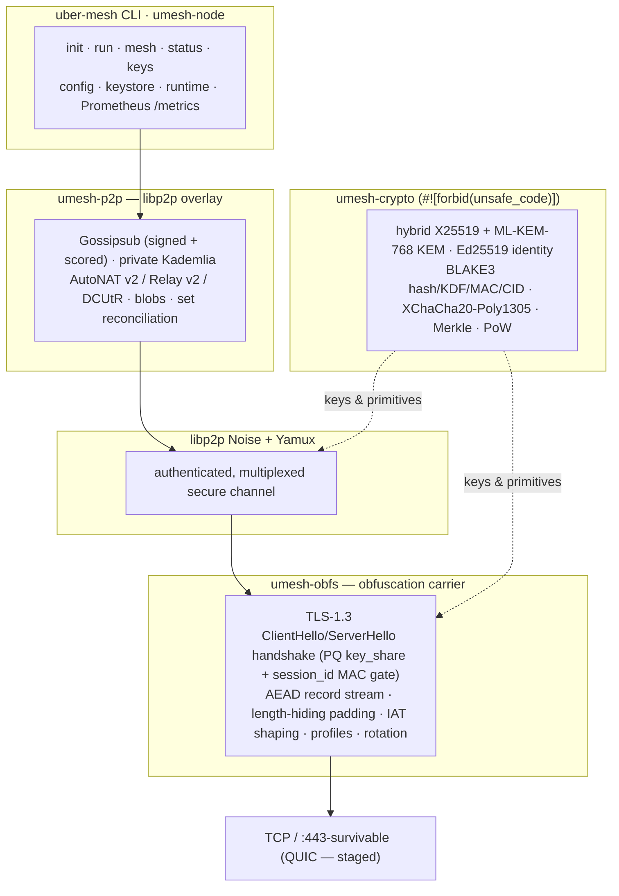
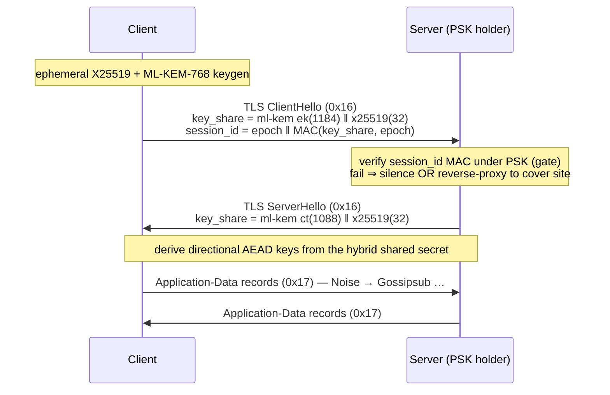

<div align="center">

# uber-mesh

**A decentralized, censorship-resistant peer-to-peer mesh network in Rust — built on modern, standardized, hybrid post-quantum cryptography.**

*Designed to keep nodes connected under aggressive DPI (Russia's TSPU, Iran's IRGFW) and to degrade gracefully toward blackout.*

[](https://github.com/AlexMelanFromRingo/uber-mesh/actions/workflows/ci.yml)
[](LICENSE)
[](https://www.rust-lang.org)
[](https://doc.rust-lang.org/edition-guide/)
[](#validation--benchmarks)
[-success.svg?style=flat-square)](#security-model)
[](#security-model)
[](https://libp2p.io)

</div>

> [!WARNING]
> **Research-grade and unaudited.** The post-quantum component (`ml-kem`) is **pre-audit**, and so is the
> wider stack. The classical X25519 half is kept *authoritative* so a flaw in the PQ half alone cannot
> break a session — but that is a mitigation, not an assurance. **Do not rely on uber-mesh for life-safety
> or anti-coercion** until an independent audit says otherwise. See [`SECURITY.md`](SECURITY.md).

---

## Contents

- [Why](#why) · [Highlights](#highlights) · [Architecture](#architecture) · [Workspace](#workspace-crates)
- [Quickstart](#quickstart) · [Censorship resistance](#censorship-resistance) · [Validation & benchmarks](#validation--benchmarks)
- [Security model](#security-model) · [Project layout](#project-layout) · [Spec-driven development](#spec-driven-development)
- [Roadmap](#roadmap) · [Contributing](#contributing) · [License](#license)

## Why

Resilience under censorship in 2025–26 comes from **agility, not a single unbreakable protocol**. Censors
combine passive fully-encrypted classification (entropy/no-header heuristics), active probing, TLS-state-machine
and SNI inspection, and volumetric throttling. uber-mesh layers a **pluggable, environment-selected
obfuscation transport** *below* a **hybrid post-quantum secure channel**, over a **decentralized libp2p
overlay** — so a node can blend with ordinary TLS traffic, refuse to reveal itself to probes, route around
blocks, and verify every message end-to-end without any central authority.

## Highlights

| Capability | What it does |
|---|---|
| 🔐 **Hybrid post-quantum** | Every link is keyed by **X25519 + ML-KEM-768** via an X-Wing-style BLAKE3 combiner. Classical half stays authoritative; all mesh data rides a PQ-keyed tunnel (no harvest-now-decrypt-later). |
| 🥷 **TLS-1.3-ClientHello mimicry** | The obfs handshake is a *structurally-valid* TLS 1.3 ClientHello → ServerHello with a PQ-hybrid `X25519MLKEM768` key_share. Defeats entropy/no-header **and** TLS-state-machine DPI; blends with real PQ-TLS. |
| 🪞 **REALITY-style probe resistance** | A peer without the shared PSK fails the gate and gets **silence** or is **reverse-proxied to a real cover site** — an active prober can't distinguish a node from a genuine TLS server. |
| 🕸️ **Decentralized overlay** | libp2p **Gossipsub** (Strict signing + scoring), **private Kademlia**, identify/ping, and the NAT trio (**AutoNAT v2 / Circuit Relay v2 / DCUtR**) — all running *over* the obfs carrier. |
| ✍️ **Signed gossip + replay protection** | Ed25519-signed, content-addressed messages with monotonic seqno, timestamp window, and an LRU dedup guard. Forgeries and replays are rejected. |
| 📦 **Content exchange & sync** | Content-addressed store + request/response blobs (`BLAKE3(bytes) == Cid`) and **negentropy-style set reconciliation**. |
| 📈 **Observable & light** | Prometheus `/metrics` on every node + provisioned Grafana; **~4 MB RSS** per leaf node, tunable Tokio worker pool (`UMESH_WORKERS`). |
| 🦀 **Pure-Rust, no `unsafe`** | `unsafe_code = "deny"` workspace-wide; `#![forbid(unsafe_code)]` in the crypto core. Default build has no C/FFI. |

## Architecture

uber-mesh stacks obfuscation **below** libp2p's Noise channel, so the entire gossip mesh inherits the
transport's DPI resistance and the data path is hybrid-PQ end to end.



The obfs handshake itself looks like an ordinary post-quantum TLS 1.3 opening on the wire:



### Workspace crates

| Crate | Role |
|-------|------|
| [`umesh-crypto`](crates/umesh-crypto) | Pure-Rust crypto core (`#![forbid(unsafe_code)]`): hybrid X25519+ML-KEM-768 KEM (X-Wing-style BLAKE3 combiner), Ed25519 identity (`PeerId = BLAKE3(pubkey)`), BLAKE3 hash/KDF/keyed-MAC/CID with domain separation, XChaCha20-Poly1305, Merkle, PoW. KATs + property tests. |
| [`umesh-obfs`](crates/umesh-obfs) | Pluggable obfuscation carrier: TLS-1.3 ClientHello/ServerHello mimicry handshake with a `session_id` MAC gate, AEAD record stream, length-hiding padding + traffic shaping, environment profiles, `ObfsTcp` + connect-time rotation, REALITY-style fallback. DPI-simulation tests. |
| [`umesh-p2p`](crates/umesh-p2p) | libp2p mesh: signed gossip + replay protection, `MeshBehaviour` (Gossipsub Strict, private Kademlia, identify, ping) + NAT trio (AutoNAT v2 / Relay v2 / DCUtR) + blob request/response (bincode codec) + negentropy-style reconciliation, content-addressed `ContentStore`, `MeshNode` driver, Prometheus metrics. |
| [`umesh-node`](crates/umesh-node) | Node orchestration: config, identity keystore (`0600`), runtime, secret-free status. |
| [`uber-mesh`](crates/uber-mesh) | The CLI binary. |

## Quickstart

```bash
git clone https://github.com/AlexMelanFromRingo/uber-mesh
cd uber-mesh

cargo build --workspace
cargo test  --workspace        # 99 tests: KATs, property tests, DPI sim, gossip/NAT/reconcile integration
cargo clippy --workspace --all-targets -- -D warnings
```

### Two-node gossip mesh (obfuscated, hybrid-PQ, probe-resistant)

The mesh runs over the obfs carrier, so peers share an obfs **PSK** (a bridge secret printed by `init`,
distributed out-of-band).

```bash
# Initialize two nodes — each prints a PSK once. Note node A's PSK.
cargo run -p uber-mesh -- --data-dir /tmp/a init      # ← copy A's PSK
cargo run -p uber-mesh -- --data-dir /tmp/b init

# Node A (bootstrap) — prints "libp2p peer: <PEER_ID>" and serves metrics on :9100/metrics
cargo run -p uber-mesh -- --data-dir /tmp/a mesh --listen /ip4/127.0.0.1/tcp/41999 --psk <A_PSK>

# Node B — dials A over the obfuscated transport using A's PSK
cargo run -p uber-mesh -- --data-dir /tmp/b mesh --listen /ip4/127.0.0.1/tcp/0 \
    --bootstrap /ip4/127.0.0.1/tcp/41999/p2p/<A_PEER_ID> --psk <A_PSK>
```

Each node prints `[uber-mesh/global] b3:<sender>: heartbeat …` (sender authenticated via Ed25519). A peer
started with the **wrong `--psk` is rejected by the obfs gate and never connects**. Inspect a node without
ever revealing secrets:

```bash
cargo run -p uber-mesh -- --data-dir /tmp/a status --json
curl -s localhost:9100/metrics | grep umesh_      # peers, gossip, handshake histogram, resources
```

<details>
<summary>Environment variables</summary>

| Var | Default | Meaning |
|---|---|---|
| `UMESH_WORKERS` | `2` | Tokio worker threads (`1` = current-thread runtime; lower = lighter footprint). |
| `METRICS_PORT` | `9100` | Prometheus `/metrics` port for the `mesh` command (`off` to disable). |
| `UMESH_SNI` | `www.cloudflare.com` | Cover-domain SNI presented in the obfs ClientHello. |
| `RUST_LOG` | `info` | Tracing filter (never logs secrets). |

</details>

Fuzz the wire parsers (nightly): `cd fuzz && cargo +nightly fuzz run obfs_record` (or `message_parse`).
Run a 100-node Docker cluster with Prometheus + Grafana under `tc-netem`: `NODES=100 bash docker/run-cluster.sh`.

## Censorship resistance

uber-mesh borrows the load-bearing idea from each major circumvention design and composes them behind one
pluggable transport seam. The table is about *ideas and posture*, not a benchmark shoot-out.

| | uber-mesh | REALITY / XTLS | Hysteria2 | AmneziaWG | obfs4 |
|---|---|---|---|---|---|
| **Carrier** | TCP (`:443`-survivable) | TCP / TLS | QUIC / UDP | WireGuard / UDP | TCP |
| **Anti-DPI** | TLS-1.3 ClientHello mimicry + entropy/probe/state-machine resistance + cover-site fallback | steals a real TLS handshake (byte-exact) | Salamander obfs + congestion control | junk packets + magic headers | uniform-random + ntor + IAT |
| **Post-quantum** | ✅ X25519 + ML-KEM-768 | ❌ classical | ❌ | ❌ | ❌ |
| **Decentralized** | ✅ libp2p mesh | ❌ client/server proxy | ❌ proxy | ❌ VPN | ❌ pluggable transport |
| **What uber-mesh takes** | — | cover-site fallback + short-id-in-`session_id` gate | QUIC+Salamander *(designed, deferred)* | AmneziaWG obfs *(designed, deferred)* | silence / active-probe resistance |

> [!NOTE]
> uber-mesh's TLS mimicry is *structurally* valid (it defeats record-type and TLS-state-machine analysis and
> blends with real X25519MLKEM768 traffic). It is **not yet** a byte-exact uTLS JA3/JA4 fingerprint of a
> specific browser, nor a full TLS-1.3 transcript — closing that is the deferred native-REALITY work. See
> [`docs/security-and-deferred.md`](docs/security-and-deferred.md).

## Validation & benchmarks

Harnesses exercising the **real code** beyond unit tests (single host, mid-2026; full method + caveats in
[`docs/benchmarks.md`](docs/benchmarks.md)):

| Scenario | Result |
|---|---|
| In-process gossip, **100 nodes** | **100% delivery**, propagation p95 ≈ **3 ms** |
| Docker **100 nodes** + Prometheus under `tc-netem` (loss 2%, 50 ms±10) | obfs handshake p95 = **147 ms** (< 150 ms target), 25 540 gossip msgs, **0 forgeries** |
| **DPI middlebox** in-path ([`tests/dpi_middlebox.rs`](crates/umesh-obfs/tests/dpi_middlebox.rs)) | obfs **passes** entropy/no-header **+** active-probing **+** TLS-state-machine censors; raw / always-answering / app-data-first flows are **blocked** |
| Throughput (loopback, AEAD records) | **267 MB/s** (aggressive IAT shaping caps bulk to 1.4 MB/s *by design*) |
| Per-node resources | RSS **~4 MB** leaf / ~33 MB bootstrap, near-idle CPU, ~4 threads (default pool) |
| Soak (3 min) · heavy chaos (kill 12/50) | RSS stable, no leak · 38 survivors keep gossiping, 0 forgeries |

> [!IMPORTANT]
> **Not faked, not closable here:** real nation-state / in-country DPI at scale, byte-exact JA3/JA4 + full
> TLS-transcript validation, true geographic distribution across real datacenters, and multi-day soak are
> out of reach of a software-only environment. The DPI middlebox is a faithful *model* of the primary
> heuristics, not a real censor. We document gaps rather than overclaim.

## Security model

- **Hybrid PQ, classical-authoritative.** Session keys combine X25519 and ML-KEM-768; a break in the
  (unaudited) PQ part alone cannot compromise a session. No hand-rolled primitives.
- **Probe resistance.** The PSK gate is a keyed BLAKE3 MAC in the TLS `session_id` (constant-time check,
  ±1-minute epoch window). Non-PSK peers get silence (obfs4 model) or a transparent cover-site proxy (REALITY model).
- **Self-sovereign identity.** `PeerId = BLAKE3(Ed25519 pubkey)`; signatures use `verify_strict`. No CA, no registry.
- **No secret leakage.** PSKs, identity seeds, and session keys are zeroized on drop and never appear in logs,
  status, errors, or metrics (only fingerprints). On-disk secrets are `0600`.
- **Memory safety.** `unsafe_code = "deny"` workspace-wide; `#![forbid(unsafe_code)]` in `umesh-crypto`.

Full policy, threat model, and reporting: [`SECURITY.md`](SECURITY.md). Deferred-work disposition:
[`docs/security-and-deferred.md`](docs/security-and-deferred.md). The PQ crates are pre-audit — pin and
re-audit before any production use.

## Project layout

```text
crates/
  umesh-crypto   pure-Rust crypto core (#![forbid(unsafe_code)])
  umesh-obfs     obfuscation carrier (TLS-mimicry handshake, AEAD record stream, shaping, profiles)
  umesh-p2p      libp2p mesh overlay (gossip, Kademlia, NAT, blobs, reconciliation) over the obfs carrier
  umesh-node     config, keystore, node orchestration, status
  uber-mesh      the CLI (init / run / mesh / status / keys show)
fuzz/            standalone nightly libFuzzer harnesses (excluded from the workspace)
docker/          scalable Docker cluster + Prometheus + Grafana + tc-netem runner
docs/            benchmarks, security-and-deferred, research dossier
specs/           Spec Kit design artifacts for 001-uber-mesh-core
.specify/        the constitution (iron rules) + Spec Kit templates
```

## Spec-driven development

uber-mesh is built with [**GitHub Spec Kit**](https://github.com/github/spec-kit): design precedes code and
the artifacts are checked in. The project's **iron rules** are seven constitutional principles
([`.specify/memory/constitution.md`](.specify/memory/constitution.md), v1.0.0):

> **I.** Security & Cryptography First *(non-negotiable)* · **II.** Censorship-Resilience by Design ·
> **III.** Decentralization & Self-Sovereign Identity · **IV.** Memory Safety & Pure-Rust Preference ·
> **V.** Test-First & Cryptographic Verification *(non-negotiable)* · **VI.** Observability & Operability ·
> **VII.** Simplicity, Versioning & Supply-Chain Integrity

The full design lives under [`specs/001-uber-mesh-core/`](specs/001-uber-mesh-core/) (`spec.md`, `plan.md`,
`tasks.md`, `data-model.md`, `research.md`, `contracts/`); the verified technical rationale is in
[`docs/research/dossier.md`](docs/research/dossier.md).

## Roadmap

**Implemented & tested** — crypto core · obfs carrier with TLS-1.3 ClientHello mimicry, probe resistance &
REALITY-style fallback · profiles / shaping / rotation · obfs **under libp2p Noise** (mesh inherits DPI
resistance) · Gossipsub + private Kademlia + AutoNAT/Relay/DCUtR · signed gossip + replay protection ·
content exchange + set reconciliation · Prometheus metrics + Grafana · node + CLI · Docker validation.

**Deferred by design** (additive behind the `ObfsTransport` seam; rationale in
[`docs/security-and-deferred.md`](docs/security-and-deferred.md)): byte-exact uTLS JA3/JA4 + full-transcript
native REALITY (needs a ClientHello-controlling TLS stack), QUIC + Salamander (needs `quinn` UDP access),
AmneziaWG (needs a WireGuard core), and a local-RF blackout tier (needs radio hardware). Tracked in
[`specs/001-uber-mesh-core/tasks.md`](specs/001-uber-mesh-core/tasks.md); release history in
[`CHANGELOG.md`](CHANGELOG.md).

## Contributing

Contributions are welcome — see [`CONTRIBUTING.md`](CONTRIBUTING.md) for the dev loop, the **test-first rule**
for crypto/protocol/parser code, the default-deny-`unsafe` policy, and the spec-driven workflow. Please also
read the [`CODE_OF_CONDUCT.md`](CODE_OF_CONDUCT.md). Report vulnerabilities privately per [`SECURITY.md`](SECURITY.md).

## License

Licensed under the **Mozilla Public License 2.0** ([`LICENSE`](LICENSE)). By contributing you agree your
contributions are licensed under MPL-2.0.

## Acknowledgements

Built on the work of [rust-libp2p](https://github.com/libp2p/rust-libp2p), the
[dalek](https://github.com/dalek-cryptography) and [RustCrypto](https://github.com/RustCrypto) ecosystems
(`ml-kem`, `chacha20poly1305`), [BLAKE3](https://github.com/BLAKE3-team/BLAKE3), and the techniques behind
REALITY/XTLS, Hysteria, AmneziaWG, and obfs4. Developed with [GitHub Spec Kit](https://github.com/github/spec-kit).
