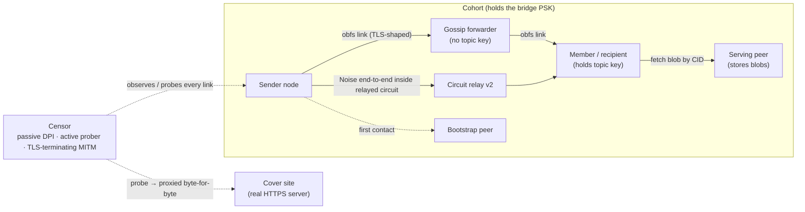

# Threat model, trust boundaries and evidence

This document answers four questions a reviewer asks first: **who can see what**, **which bytes are real
TLS and which only look like it**, **how strongly each property is evidenced**, and **which test backs
which requirement**. It complements [`ARCHITECTURE.md`](../ARCHITECTURE.md) (how it works),
[`security-and-deferred.md`](security-and-deferred.md) (rationale + deferred work) and the wire contracts in
[`specs/001-uber-mesh-core/contracts/`](../specs/001-uber-mesh-core/contracts/).

## 1. Parties and trust boundaries

Trust levels:

| Party | Trusted for | NOT trusted for |
|---|---|---|
| Censor (network) | nothing | anything — it sees all bytes on every link |
| Cover site | serving its own content to probers | — (unaware of uber-mesh) |
| Cohort member *without* a topic key (forwarder, serving peer, relay, bootstrap) | forwarding / storing / relaying | reading or altering sealed payloads and blobs |
| Member *with* the topic key | reading that topic | impersonating another sender (signatures + identity PoW) |
| Holder of the bridge PSK | reaching listeners, passing the obfs gate | reading other peers' traffic (Noise + per-link keys) or forging identities |

## 2. What each party sees

| Observer | Sees | Does **not** see |
|---|---|---|
| Passive DPI on a link | a Chrome-133 TLS 1.3 ClientHello (JA4 `t13d1516h2_8daaf6152771_d8a2da3f94cd`), the cover site's server-flight *layout*, then TLS application-data records with shaped lengths/timing | anything inside the records; that it is uber-mesh (the gate tag is a MAC, no cleartext fields) |
| Active prober (no PSK, or replaying a captured hello) | the **real cover site** (every byte proxied, real certificate) | the bridge |
| TLS-terminating MITM (trusted CA) | its own handshake with the client fails (no server confirmation); its own ClientHello to the bridge has no MAC → proxied to the real cover site | the bridge or any payload. **No tunnel survives a full MITM: the guarantee is non-identification, not reachability.** |
| Bridge-PSK holder on-path | can complete the obfs layer as a fake bridge | the inner Noise session (authenticated by libp2p PeerIds) and the node hello (signs the obfs channel binding) |
| Circuit relay v2 | both endpoints' PeerIds, timing, volume | content (Noise is end-to-end through the circuit) |
| Gossip forwarder without topic key | topic name, sender id, seqno, timestamp, size (+41 B), timing | sealed content (XChaCha20-Poly1305, AAD binds topic/sender/seqno/timestamp) |
| Serving peer | blob ciphertext, CID, size, who fetches it | blob plaintext (fresh content key, delivered only inside a sealed message) |
| Member with topic key | plaintext of that topic | other topics |

Public (unsealed) topics are readable by every forwarder **by design**; the CLI prints `PUBLIC` for them.

## 3. Real TLS vs imitation, byte by byte

| Bytes on the wire | Status |
|---|---|
| ClientHello record | **Real TLS 1.3 structure**, field-for-field Chrome 133+ (GREASE, 15 suites, 16 extensions, ALPS `0x44cd`, ECH GREASE). The `key_share` carries a real X25519MLKEM768 share = our X-Wing public key. `legacy_session_id` is our gate MAC (indistinguishable from random). |
| ServerHello record | **Real TLS 1.3 structure**, cloned from the cover site's learned shape (cipher, group, extension order, length). |
| ChangeCipherSpec | Real (middlebox-compat CCS, as servers send). |
| Server "encrypted handshake" records | **Imitation**: same count and sizes as the cover site's EncryptedExtensions/Certificate/CertificateVerify/Finished records, but the bodies are random bytes plus our AEAD server confirmation in the last 53 B. Indistinguishable without the TLS traffic keys, which only a real TLS client of the cover site would have. |
| Client CCS + "Finished" record | **Imitation**: Finished-sized record carrying our AEAD client confirmation. |
| Application-data records (`0x17`) | **Our own AEAD record layer** (XChaCha20-Poly1305) in TLS application-data framing, padded per profile. |

What this does *not* claim: a TLS-terminating party cannot complete a TLS handshake with us; NewSessionTicket
records are not sent; only one Chrome generation/platform is reproduced; the cover domain does not resolve to
the bridge's IP (a censor correlating SNI with DNS can notice that — choose a cover domain hosted on the
same CDN/IP range where possible).

## 4. Cryptographic layering (what "post-quantum" covers)

| Property | Mechanism | PQ? |
|---|---|---|
| Link confidentiality | obfs records under keys from **X-Wing** (X25519 + ML-KEM-768, draft-11, KAT-verified) ‖ PSK ‖ transcript | ✅ hybrid (classical half authoritative) |
| Inner channel | libp2p Noise XX (X25519) + Yamux, *inside* the PQ link | classical, but only reachable by first breaking the PQ link |
| Node / message authentication | Ed25519 signatures, `PeerId = BLAKE3(pubkey)`, identity PoW | ❌ classical — a future CRQC could forge identities (not decrypt recorded traffic) |
| Payload confidentiality across forwarders | sealed topics: XChaCha20-Poly1305 under a 256-bit topic key | ✅ symmetric (256-bit keys are PQ-adequate) |
| Forward secrecy | per-link ephemeral X-Wing keys | ✅ per link; ❌ for sealed topics (static topic key; epoch keys are derivable — deferred) |

So: recorded traffic is protected against harvest-now-decrypt-later; *authentication* is classical.

## 5. Evidence levels

Each property is labelled by the strongest evidence it has:

- **I** — implemented
- **M** — tested in a model (unit/integration tests, in-process or Docker on one host, simulated DPI)
- **X** — conformance confirmed against an external implementation or official vectors
- **N** — validated on a real network against a real censor

| Property | I | M | X | N |
|---|---|---|---|---|
| X-Wing hybrid KEM | ✅ | ✅ | ✅ official draft-11 vectors | — |
| AEAD / BLAKE3 / X25519 primitives | ✅ | ✅ | ✅ RFC 7748, BLAKE3 KATs | — |
| Chrome-133 ClientHello (JA4) | ✅ | ✅ | ✅ JA4 recomputed independently (standard SHA-256) | — |
| Cover-site flight mimicry | ✅ | ✅ (local TLS 1.3 servers) | — | — |
| Probe resistance (silence / proxy) | ✅ | ✅ (active-probe + replay tests) | — | — |
| Mutual key confirmation, no PSK-less MITM | ✅ | ✅ | — | — |
| Entropy / state-machine DPI evasion | ✅ | ✅ (simulated classifiers) | — | — |
| Signed gossip, replay rejection, identity PoW | ✅ | ✅ | — | — |
| Sealed topics / encrypted blobs | ✅ | ✅ | — | — |
| NAT traversal (AutoNAT v2, relay, DCUtR) | ✅ | ✅ (relay reservation) | — | — |
| 100-node operation | ✅ | ✅ (Docker, tc-netem, one host) | — | — |

**Nothing has level N yet.** No measurement in this repository proves behaviour against TSPU/GFW; that
needs field testing, and an independent cryptographic review of `umesh-crypto` + `umesh-obfs` (the
contracts and vectors are written to make that review possible).

## 6. Requirement → test traceability

| Req | Test(s) | Level / limits |
|---|---|---|
| FR-001 authenticated confidential links | `dpi_sim::establishes_and_exchanges_data`, `handshake_security::round_trip_with_tls13_wire_shape` | M |
| FR-002 probe-resistant listeners | `dpi_sim::active_probe_gets_silence`, `dpi_sim::probe_is_proxied_to_cover_site`, `handshake_security::audit_replayed_client_hello_goes_to_fallback`, `…http_probe_forwarded_immediately_and_completely`, `transport_profile::prober_is_spliced_to_configured_cover_site`, `cover_mimicry::http_probe_still_proxied_in_cover_mode` | M |
| FR-003 pluggable transports | `ObfsTransport` trait; only obfs-TCP exists | I (one transport) |
| FR-004 health checks / rotation | `dpi_sim::rotates_past_dead_endpoint`, `handshake_security::client_timeout_rotates_past_silent_endpoint` | M (connect-time rotation only) |
| FR-005 UDP/QUIC opportunistic | — | **deferred** (no QUIC transport) |
| FR-006 traffic shaping | shaping/bytestream unit tests, `transport_profile::shaped_and_unshaped_nodes_gossip` | M |
| FR-007 hybrid PQ key agreement | `xwing_kat::*`, `kat::hybrid_kem_agreement_and_sizes` | X |
| FR-008 AEAD on the wire | `props::aead_*`, `dpi_middlebox::obfs_passes_entropy_dpi_box` | M |
| FR-009 signed identity/messages | `gossip_validate::two_nodes_gossip_a_validated_message`, gossip unit tests | M |
| FR-010 forward secrecy | per-connection ephemeral X-Wing (`kem` tests) | M (no FS for sealed topics) |
| FR-011 self-certifying content | `props::cid_is_function_of_content`, `blob_exchange::requests_and_verifies_a_blob` | M |
| FR-012 replay rejection | gossip unit tests (sliding window, eviction floors, restart), `…audit_replayed_client_hello…` | M |
| FR-013 secrets never exposed | redacted-`Debug` / zeroize tests (crypto, obfs, node config) | M |
| FR-014 no mandatory central server | Kademlia bootstrap + any-peer bootstrap; `nat_relay::*` | M (bootstrap list is operational) |
| FR-015 non-enumerable discovery | private `/uber-mesh/kad/1.0.0` + `/uber-mesh/meshsub`, all inside the PSK-gated carrier | I/M |
| FR-016 NAT participation | `nat_relay::connects_to_relay_node_over_obfs`, `…relay_reservation_accepted_with_confirmed_address` | M |
| FR-017 reachability detection | AutoNAT v2 client+server wiring | I |
| FR-018 peer scoring | node test "PoW-less message's forwarder is penalised", `gossip_validate::sender_below_network_pow_is_not_delivered` | M |
| FR-019 single binary | `uber-mesh` CLI tests | M |
| FR-020 status | `umesh-node::status` tests | M |
| SC-001 DPI simulation | `dpi_middlebox::*`, `fingerprint::ja4_is_chrome_133_for_every_hello` | M (simulated censor) |
| SC-004 100% forged/replayed rejected | gossip + handshake regression suites | M |
| SC-005 relay reachability ≤ 5 s | `nat_relay::*` | M (loopback) |
| SC-007 KAT/property/fuzz | `kat`, `xwing_kat`, `props`, 9 fuzz targets in CI | X/M |

## 7. Residual risks and non-goals

- **Operational bootstrapping.** The bridge PSK, cover domain and first bootstrap addresses are distributed
  out of band. If every known peer is blocked, the DHT cannot help a new node find others.
- **Classical authentication** (Ed25519/Noise) — see §4.
- **Sybil pressure on replay state.** Identity PoW (24 bits) prices fresh identities; a stockpile can still
  be reused after replay state expires, so it is friction, not a barrier (bounded impact: ≤ 30 s delay for
  a random, per-node-keyed subset of newcomers).
- **Metadata.** Forwarders see topic names, sender ids, sizes and timing even for sealed topics.
- **Benchmarks** are single-host (in-process, Docker + tc-netem). Repeated multi-host runs with confidence
  intervals and field tests are still to be done.
- **Independent review.** Everything above is self-assessed plus automated adversarial review; an external
  cryptographic audit is still required before relying on it in a hostile environment.
